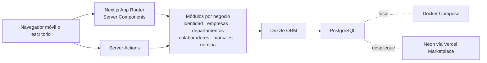

# Kru Marcaje

Aplicación web de marcaje y preparación de novedades de nómina para empresas en Venezuela. Resuelve la [prueba técnica](./prueba-tecnica-kru-marcaje.md) y añade aprobación de empresas, departamentos, políticas versionadas, validación opcional de ubicación y paneles adaptables a móvil.

## Probar en local

Requisito: Docker con Docker Compose. No hace falta crear `.env` ni instalar Node.js en la máquina anfitriona.

```bash
docker compose up --build
```

Como atajo, `bash scripts/local.sh` ejecuta el mismo arranque. El script acepta también `down`, `logs`, `test`, `migrate` y `seed`, siempre con los valores locales de Docker Compose.

Abrir [http://localhost:3000](http://localhost:3000). El contenedor espera PostgreSQL, aplica las migraciones y crea los datos de demostración de manera idempotente. La base persiste en un volumen Docker. `Ctrl+C` detiene los contenedores; `docker compose down` los apaga sin borrar el volumen.

| Perfil local | Acceso | Contraseña |
| --- | --- | --- |
| Dueño de plataforma | `owner@kru.demo` | `Demo12345!` |
| RRHH empresa A | `rrhh@empresa-a.demo` | `Demo12345!` |
| Colaborador A | Empresa `empresa-a`, cédula `12345678` | `Demo12345!` |
| RRHH empresa B | `rrhh@empresa-b.demo` | `Demo12345!` |

La empresa A incluye un turno del **5 de octubre de 2026, 06:00–16:00 Caracas**. Consultar la semana de esa fecha en **Nómina y reportes** muestra 10 horas totales y 2 horas extra diurnas. La empresa B demuestra el aislamiento de datos.

### Comandos de desarrollo

Dentro de Docker se puede ejecutar `docker compose exec app npm run <script>`. Si se dispone de Node.js 22, también se puede usar `npm ci` y ejecutar los scripts npm con `DATABASE_URL` y `SESSION_SECRET` configuradas.

| Script | Función |
| --- | --- |
| `dev`, `build`, `start` | Next.js en desarrollo, compilación y producción |
| `db:generate`, `db:migrate`, `db:seed` | Generar/aplicar migraciones y datos iniciales |
| `lint`, `typecheck` | ESLint y TypeScript |
| `test`, `test:coverage` | Jest; las pruebas con PostgreSQL se activan cuando existe `DATABASE_URL` |
| `test:e2e` | Playwright contra `http://localhost:3000`; requiere Chrome o Chromium instalado |

Para ejecutar Jest con PostgreSQL sin configurar variables:

```bash
docker compose run --rm --entrypoint npm app run test:coverage
```

## Arquitectura



`src/app` contiene las rutas y estados de interfaz; `src/modules` concentra acciones, consultas, validaciones y cálculo por función de negocio; `src/db` contiene el esquema y cliente de datos. El cálculo de nómina, las reglas de fecha, el CSV, la geocerca y las comprobaciones de permiso son funciones independientes del framework. Cada turno conserva la versión de política de su departamento vigente al abrirlo. Las migraciones SQL están en `drizzle/`.

La cookie `kru_session` es `HttpOnly`, `SameSite=Lax` y `Secure` en producción. El JWT firmado dura 30 días y contiene únicamente un identificador opaco de sesión y marcas temporales; el rol, empresa, nombre y cédula se consultan en PostgreSQL para cada solicitud protegida. Las acciones y consultas aplican el ámbito de empresa en el servidor. El dueño de plataforma gestiona empresas y RRHH; no puede consultar marcajes ni reportes. El proxy de Next.js solo hace la redirección temprana de solicitudes sin cookie: la autorización definitiva está en el servidor.

## Reglas importantes

- La empresa solicita el registro; el dueño de plataforma la aprueba antes de que RRHH pueda entrar. Al registrarla se crea el departamento **General**.
- Un colaborador pertenece a un departamento activo. RRHH puede añadir departamentos y mover colaboradores; los turnos anteriores conservan su departamento y reglas originales.
- La hora del marcaje proviene del servidor y se guarda con precisión de minutos. Un índice único impide dos turnos abiertos para la misma persona. Correcciones requieren motivo y dejan historial de antes/después.
- La ubicación por departamento es opcional. Se acepta una lectura reciente y suficientemente precisa dentro de 20, 30 o 40 metros según la configuración. Solo se guardan distancia y precisión, no las coordenadas del colaborador.
- Los límites de día y período siguen `America/Caracas`. Un turno pertenece al día local de entrada. Las primeras 8 horas son ordinarias; la franja nocturna es 19:00–05:00; el redondeo a dos decimales ocurre después de sumar minutos por período. La alerta semanal se calcula con la semana completa aunque la quincena termine a mitad de semana.
- El CSV usa `;`, una fila por colaborador y los nombres de columna exactos solicitados. Los campos de texto se escapan y se neutralizan posibles fórmulas de hoja de cálculo.

## Decisiones y alternativas

| Decisión | Motivo | Alternativa descartada |
| --- | --- | --- |
| Next.js App Router con Server Actions | Mantiene las mutaciones y los permisos en el servidor, con una sola aplicación desplegable. | API REST adicional para este alcance. |
| PostgreSQL + Drizzle | Restricciones e índices únicos protegen invariantes incluso ante solicitudes simultáneas; migraciones revisables. | Estado persistente en memoria o documentos sin restricciones. |
| Políticas versionadas por departamento | Un cambio futuro no altera el cálculo histórico de un turno. | Una sola configuración mutable por empresa. |
| Sesión JWT opaca respaldada por tabla de sesiones | Permite revocación y evita incluir datos personales o roles en el navegador. | JWT con rol y empresa como única fuente de permisos. |
| Cálculo por segmentos de minuto | Clasifica correctamente turnos que cruzan las 19:00, 05:00 u ocho horas ordinarias. | Redondear o clasificar el turno completo. |
| Zustand solo para navegación móvil | El estado de negocio permanece en PostgreSQL y Server Components. | Duplicar datos y permisos en un store de cliente. |

## Verificación y límites

Jest cubre cálculo, fechas, geocerca, autenticación, acciones y consultas críticas con pruebas de integración contra PostgreSQL. Playwright comprueba registro y aprobación, acceso por rol, separación entre empresas, exportación, corrección y pantallas de 320 px. Los dos ejemplos de cálculo del enunciado están en `src/modules/payroll/calculate.test.ts`. En la ejecución con PostgreSQL se obtuvo **92,37 % de sentencias, 98,07 % de líneas y 77,86 % de ramas** en `src/modules`; la cobertura de ramas aún puede crecer con más combinaciones de entradas inválidas y errores. Las rutas ejercitadas por Playwright no forman parte de la métrica de Jest.

La ubicación del navegador se puede manipular; este control reduce errores casuales, pero no prueba presencia física. No se incluyen biometría, turnos programados, pausas, nómina monetaria ni integraciones externas porque la prueba se centra en el marcaje y las novedades de horas. Las correcciones modifican el turno y registran auditoría; para un sistema de nómina real se añadiría una política de cierre de períodos y aprobación dual.

Próximos pasos: completar la cobertura de acciones y consultas, bloqueo transaccional de correcciones simultáneas, pruebas de carga y accesibilidad, observabilidad, recuperación de contraseña, invitaciones seguras y límites de solicitudes de inicio de sesión. Antes de comercializar la geocerca se necesitaría un mecanismo adicional de verificación presencial.

## Despliegue de la prueba

La aplicación está preparada para Vercel y PostgreSQL de Neon conectado por Vercel Marketplace. El proyecto de Vercel debe definir `DATABASE_URL`, `SESSION_SECRET` (32 caracteres aleatorios o más), `APP_ENV=production`, `PLATFORM_ADMIN_EMAIL` y `PLATFORM_ADMIN_PASSWORD`. Aplicar migraciones con `npm run db:migrate` desde un entorno autorizado antes de publicar. Ejecutar `npm run db:seed` una vez para crear al dueño. Para crear las cuentas de prueba A/B en un entorno público de demostración, ejecutar la semilla con `SEED_DEMO=true` y `DEMO_PASSWORD` configurada; no habilitar esta opción en un sistema real.

La URL pública y el repositorio remoto se añadirán al conectar las cuentas de Vercel, Neon y GitHub del titular. Actualmente este checkout no tiene remoto Git configurado ni acceso autenticado a esos servicios, así que la entrega pública aún está pendiente.

Documentos complementarios: [diseño aprobado](./docs/superpowers/specs/2026-10-15-kru-marcaje-design.md), [bitácora de IA](./docs/ai-log.md) y [nota de negocio](./docs/business-note.md).
